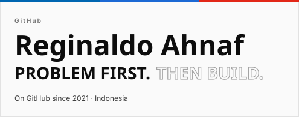
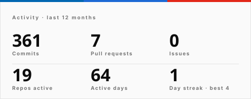
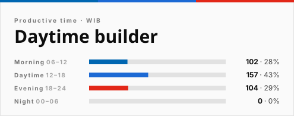
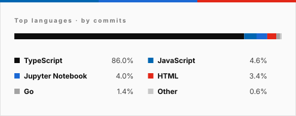

## Hello, I'm Regin 👋

I'm Reginaldo. I start with the problem, then learn whatever it takes to solve it, across design, data, AI and the web.

Hand me a dataset with an engine in it, a pit lane or a pipeline, and I lose track of time. Lately that has meant scoring pit stops, rating drivers across seven decades, and hunting for where oil and gas fields leak value. Same habit every time, find the question behind the numbers.

  
  
  
  

  
  

  
  

<!--UPDATED-->Last updated on 10/11/2026 00:48:33 UTC<!--/UPDATED--> · refreshed every 6 hours
